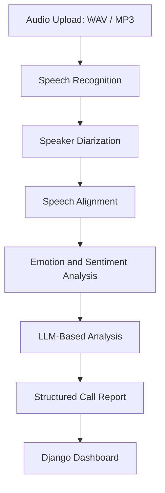

# AI-Powered Call Center Analysis System

An AI-powered platform for automated call center performance analysis, designed to help businesses evaluate customer interactions, monitor agent performance, and extract actionable insights from Arabic customer service calls.

**Graduation Project — A+ / Excellent**

---

## Overview

Evaluating customer service calls manually is time-consuming, expensive, and difficult to scale. Traditional quality assurance teams can only review a small percentage of daily calls, leaving valuable insights undiscovered.

Our system automates the call analysis process using Artificial Intelligence, Natural Language Processing, and Speech Processing technologies.

The platform transforms recorded customer conversations into structured reports, enabling businesses to analyze customer sentiment, agent performance, and conversation quality more efficiently.

The system particularly focuses on **Arabic and Egyptian Arabic customer service conversations**, addressing challenges associated with Arabic speech recognition and language understanding.

## Key Features

- **Automated Speech Recognition (ASR):** Converts recorded audio into text.
- **Speaker Diarization:** Identifies different speakers throughout the conversation.
- **Speech Alignment:** Aligns transcribed text with corresponding audio segments.
- **Emotion Analysis:** Detects emotional patterns in customer conversations.
- **Sentiment Analysis:** Analyzes customer sentiment and interaction tone.
- **AI-Powered Call Reports:** Uses an LLM to generate structured summaries and insights.
- **Agent Performance Analysis:** Supports evaluating customer service interactions.
- **Interactive Dashboard:** Visualizes call analysis results and performance metrics.

## System Architecture

The system follows a multi-stage AI pipeline:



### Processing Pipeline

1. **Audio Input:** Receives recorded customer service calls.
2. **Speech-to-Text:** Transcribes Arabic speech into text using Whisper-based ASR.
3. **Speaker Diarization:** Identifies speakers using Pyannote Audio.
4. **Alignment:** Associates transcription segments with their corresponding timestamps.
5. **Emotion Analysis:** Detects emotional patterns using a fine-tuned Arabic BERT-based model.
6. **LLM Analysis:** Uses Qwen 2.5 to generate meaningful summaries and structured insights.
7. **Visualization:** Presents the results through an interactive dashboard.

## Technology Stack

| Category | Technologies |
|---|---|
| Programming Language | Python |
| Speech Recognition | Whisper / Faster-Whisper |
| Speaker Diarization | Pyannote Audio |
| NLP & Emotion Analysis | AraBERTv2, PyTorch |
| LLM | Qwen 2.5 |
| Backend | Django, FastAPI |
| AI Frameworks | PyTorch, Hugging Face |
| Database | SQLite |
| Visualization | Chart.js |
| Workflow Orchestration | LangGraph |

## Model Evaluation

The project explored Arabic speech recognition and emotion classification models.

### Arabic Speech Recognition

Evaluation was conducted using the MGB-3 Arabic speech dataset.

| Metric | Result |
|---|---:|
| Word Error Rate (WER) | 0.3170 |
| Word Accuracy | 68.30% |
| Character Accuracy | 80.04% |

Additional experiments were conducted using smaller evaluation subsets to compare performance.

### Emotion Classification

The emotion classification experiments compared multiple Arabic language models.

| Model | Accuracy |
|---|---:|
| AraBERTv2 | 80.5% |
| Arabic BERT | 74.2% |
| DistilBERT | 66.4% |

AraBERTv2 achieved the highest accuracy among the evaluated models.

## Dashboard

The Django-based dashboard provides an interface for reviewing call analysis results, exploring employee information, and visualizing performance insights.

### Screenshots

_Add screenshots of the actual system here._

```markdown


```

## Installation

> Update these instructions according to the actual repository structure and dependencies.

### 1. Clone the repository

```bash
git clone <YOUR_REPOSITORY_URL>
cd <YOUR_PROJECT_FOLDER>
```

### 2. Create a virtual environment

```bash
python -m venv venv
```

Activate it:

**Windows**
```bash
venv\Scripts\activate
```

**Linux / macOS**
```bash
source venv/bin/activate
```

### 3. Install dependencies

```bash
pip install -r requirements.txt
```

### 4. Run the Django application

```bash
python manage.py migrate
python manage.py runserver
```

Open the local development server in your browser:

```text
http://127.0.0.1:8000/
```

_The AI inference services may require additional configuration, model downloads, and environment variables._

## Project Impact

The system aims to address several operational challenges in customer service:

- Reduce dependence on manual call reviews.
- Enable more scalable quality assurance.
- Identify customer sentiment and emotional trends.
- Support data-driven agent performance evaluation.
- Provide actionable insights from Arabic customer interactions.

## Future Improvements

- Real-time call analysis.
- Advanced Arabic dialect recognition.
- More comprehensive agent performance metrics.
- Integration with CRM and call center platforms.
- Scalable deployment using Docker and cloud infrastructure.
- Advanced analytics and predictive customer satisfaction modeling.

## Contributors

Developed as a graduation project at the **Faculty of Computers and Artificial Intelligence, Cairo University**.

## Acknowledgements

Special thanks to our supervisors and everyone who contributed to the development and evaluation of this project.
